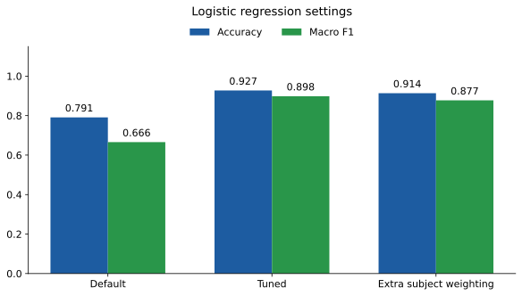

# Email Classification for Financial Services

Route client emails to Account Management, Investment Advisory, Loan Processing, Insurance Claims or Other.

The project uses TF-IDF and tuned logistic regression. It trains on 44 labelled emails and produces a category and confidence score for 12 unlabelled emails.

## Run the classifier

Use Python 3.12. Open a terminal in this folder, where `run.py` is located.

```powershell
python -m pip install -r requirements.txt
python run.py
```

The three steps run in order.

1. **Ingestion** reads the HTML files, combines the subject and body, and matches training labels by filename.
2. **Modelling** selects settings using cross-validation and macro F1, then trains the final model on all labelled emails.
3. **Reporting** saves each email's ID, predicted category and confidence score.

The final predictions are in [outputs/results.csv](outputs/results.csv). Confidence is the highest predicted class probability. Staff should check routes during a pilot while more labelled emails are collected.

## Files

The three main folders follow the assignment components: `Ingestion/`, `Modelling/` and `Reporting/` (simple reporting). `run.py` runs them in that order. Evaluation scripts, figures and the written report support the submission.

```text
Ingestion/       Read and prepare the emails
Modelling/       Train the classifier and predict class probabilities
Reporting/       Save the required results CSV
data/            Supplied emails and training labels
outputs/         Final predictions and saved model
Evaluation/      Comparison scripts, results/ CSVs and figures/ diagrams
run.py           Run ingestion, modelling and reporting
requirements.txt
README.md
report.tex
report.pdf
```

| Location | Purpose |
|---|---|
| `data/train/` and `data/test/` | Supplied HTML emails |
| `data/train_labels.csv` | Known categories, matched by filename |
| `Ingestion/ingestion.py` | Read and prepare the emails |
| `Modelling/modelling.py` | Tune, train and save the model |
| `Reporting/reporting.py` | Write the prediction CSV |
| `Evaluation/` | Compare models and export figures |
| `outputs/` | Saved model and final predictions |
| `Evaluation/results/` | Comparison scores and confusion matrices |
| `Evaluation/figures/` | SVG and PNG diagrams |
| `report.tex` | LaTeX report source |

Training labels use filenames. The results CSV uses the email IDs inside the HTML.

## Compare the models

After running the classifier, run these commands from the same folder.

```powershell
python Evaluation/compare_classifiers.py
python Evaluation/compare_subject_weighting.py
python -m pip install -r requirements-figures.txt
python Evaluation/export_figures.py
```

The classifier comparison tests logistic regression, Multinomial Naive Bayes and SGD on the same held-out emails. Settings are selected within each training split.

The settings comparison tests default, tuned and subject-weighted logistic regression using repeated cross-validation. TF-IDF learns its vocabulary from the training emails in each split.

| Classifier | Correct emails | Accuracy | Macro F1 |
|---|---:|---:|---:|
| Logistic regression | 43/44 | 97.73% | 0.966 |
| Multinomial Naive Bayes | 41/44 | 93.18% | 0.904 |
| SGD | 41/44 | 93.18% | 0.904 |

| Logistic regression version | Mean accuracy | Mean macro F1 |
|---|---:|---:|
| Default | 79.09% | 0.666 |
| Tuned | 92.73% | 0.898 |
| Extra subject weighting | 91.36% | 0.877 |

The two comparisons use different evaluation splits. Their logistic regression scores therefore differ. These are development results from a small dataset that also informed model selection. A larger independent test set is needed to confirm performance.

## Figures for the report

The Matplotlib script creates six confusion matrices and two comparison charts as SVG files. The matrices use actual categories as rows and predicted categories as columns. Each cell shows a count. Darker blue means a higher count. Comparison bars use blue for accuracy and green for macro F1.

Classifier matrices contain 44 predictions. Settings matrices contain 220 predictions because each email is evaluated five times.





SVGs can be scaled without losing sharpness.
The script also saves three 300 dpi PNGs used by `report.tex`. Run `pdflatex report.tex` twice from this folder to build the report.

## Reuse the saved model

With prepared test data, run:

```powershell
python Reporting/reporting.py
```

This loads `outputs/email_classifier.joblib` and writes `outputs/results.csv`. Run ingestion first if the HTML inputs have changed.

