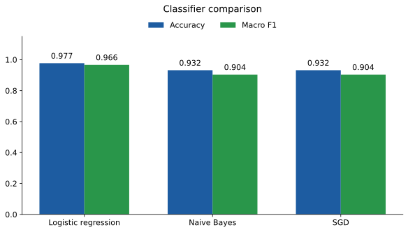
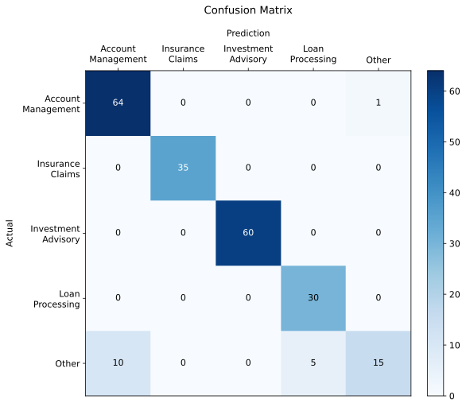

# Email Classification for Financial Services

## 1. Project motivation

This project explores how a small text classifier can help route client emails to the right department. It was built around a financial services assignment for RedRock, a fictional company where incorrect routing could delay responses.

The aim was to build a simple workflow that could be explained, tested and run locally.

## 2. What the project does

The program reads email subjects and bodies from HTML files, learns from 44 labelled examples, and classifies 12 unlabelled emails into one of five categories:

- Account Management
- Investment Advisory
- Loan Processing
- Insurance Claims
- Other

It saves each email's ID, predicted category and confidence score to [outputs/results.csv](outputs/results.csv).

TF-IDF turns the text into numbers, and logistic regression uses those numbers to choose a category. The confidence score is the highest probability returned by the model. Its relationship to actual correctness has not been independently tested.

The work is split into the three components requested in the assignment.

```text
Ingestion/          Read and prepare the emails
Modelling/          Tune, train and save the classifier
Reporting/          Write the final predictions CSV
data/               Supplied HTML emails and training labels
outputs/            Saved classifier and final predictions
Evaluation/
    results/        Comparison scores and confusion matrices
    figures/        SVG and PNG charts
    compare_classifiers.py
    compare_subject_weighting.py
    export_figures.py
run.py              Run the three main steps
requirements.txt
requirements-figures.txt
report.pdf
```

## 3. Tools and libraries used

- Python 3.12
- pandas for reading labels and writing CSV files
- Beautiful Soup for extracting email text from HTML
- scikit-learn for TF-IDF, classification and cross-validation
- joblib for saving and loading the trained model
- Matplotlib for evaluation charts

The model runs locally using open-source tools. No API key is required.

## 4. How to set up and run

### Before starting

Install Python 3.12 and Git. On Windows, enable the Python launcher when installing Python. Internet access is needed to clone the repository and install the packages.

### Windows PowerShell

Open PowerShell and run:

```powershell
git clone https://github.com/khongela/email-classifier.git
cd email-classifier
py -3.12 --version
py -3.12 -m venv .venv
.\.venv\Scripts\python.exe -m pip install --upgrade pip
.\.venv\Scripts\python.exe -m pip install -r requirements.txt
.\.venv\Scripts\python.exe run.py
```

These commands use the virtual environment directly, so activation is unnecessary.

### macOS or Linux

With Python 3.12 and Git installed:

```bash
git clone https://github.com/khongela/email-classifier.git
cd email-classifier
python3.12 -m venv .venv
.venv/bin/python -m pip install --upgrade pip
.venv/bin/python -m pip install -r requirements.txt
.venv/bin/python run.py
```

### Expected output

Keep the terminal in the repository root, where `run.py` is located. The supplied input files are under `data/train/`, `data/test/` and `data/train_labels.csv`.

The program runs ingestion, modelling and reporting in order. It prints the selected settings and the 12 predictions, and creates:

| File | Contents |
|---|---|
| `data/train.csv` | Prepared training emails and labels |
| `data/test.csv` | Prepared unlabelled emails |
| `outputs/email_classifier.joblib` | Trained TF-IDF and logistic regression pipeline |
| `outputs/results.csv` | Final predictions |

The results CSV has exactly these columns:

```text
email_id,predicted_category,confidence_score
```

Labels are matched using filenames. The output uses the email IDs inside the HTML files.

### Run individual steps

On Windows:

```powershell
.\.venv\Scripts\python.exe Ingestion/ingestion.py
.\.venv\Scripts\python.exe Modelling/modelling.py
.\.venv\Scripts\python.exe Reporting/reporting.py
```

Run ingestion before training. After the model has been saved, reporting can be run on its own using the prepared test CSV.

### Reproduce the evaluation and figures

Run the main workflow first, then:

```powershell
.\.venv\Scripts\python.exe Evaluation/compare_classifiers.py
.\.venv\Scripts\python.exe Evaluation/compare_subject_weighting.py
.\.venv\Scripts\python.exe -m pip install -r requirements-figures.txt
.\.venv\Scripts\python.exe Evaluation/export_figures.py
```

On macOS or Linux, replace `.\.venv\Scripts\python.exe` with `.venv/bin/python`.

Evaluation takes longer than the main workflow because it repeatedly trains and tests models. Scores and matrices are saved in `Evaluation/results/`. The figure script reads these files and creates eight SVG charts, plus three PNGs, in `Evaluation/figures/`.

The initial comparison evaluates each email once. The settings comparison evaluates each email five times. Its confusion matrices therefore contain 220 predictions from 44 distinct emails.

| Classifier | Correct emails | Accuracy | Macro F1 |
|---|---:|---:|---:|
| Logistic regression | 43/44 | 97.73% | 0.966 |
| Multinomial Naive Bayes | 41/44 | 93.18% | 0.904 |
| SGD | 41/44 | 93.18% | 0.904 |

| Logistic regression version | Mean accuracy | Mean macro F1 |
|---|---:|---:|
| Default | 79.09% | 0.666 |
| Tuned | 92.73% | 0.898 |
| Extra subject weighting | 91.36% | 0.877 |

The comparisons use different evaluation splits, which explains the different logistic regression scores.





### Common setup problems

- **Python 3.12 cannot be found.** Install that version, reopen the terminal and check `py -3.12 --version` on Windows.
- **A package cannot be imported.** Install the requirements with the same virtual environment interpreter used to run the scripts.
- **A data file cannot be found.** Check that the terminal is inside `email-classifier`, alongside `run.py`.
- **A prepared CSV is missing.** Run ingestion or the complete workflow first.
- **Package installation fails.** Check the Python version and internet connection. The main dependencies use fixed versions.

## 5. Challenges faced

The small dataset made evaluation sensitive to which emails were used for training and testing. Cross-validation helped compare approaches, but the results still need confirmation on fresh emails.

The Other category was harder to classify because it covers messages outside the four specialist categories. Its mistakes were easier to see in the confusion matrix than in the overall accuracy.

Email filenames and internal email IDs also had different roles. Labels had to be joined by filename while predictions had to preserve the internal IDs.

## 6. What the project showed

Tuning improved the logistic regression baseline. Giving the subject extra weight did not improve the results, so the final approach uses the combined subject and body.

Keeping TF-IDF inside the training pipeline allowed each evaluation model to learn its vocabulary from its training emails. Comparing models on the same splits also made their results easier to assess.

The scores are development estimates from a dataset used during model selection. Staff review during a pilot and a larger independent test set would provide better evidence of how the system handles new messages.

## 7. Next steps

Collect more verified emails, especially examples of Other, and track staff corrections, routing errors and response delays.

Email threads, attachment text, sender and recipient details could provide useful context. MiniLM embeddings could be compared with TF-IDF to test whether meaning beyond exact words improves classification. An LLM using similar past emails and routing guidance could also be explored when more verified examples are available.

